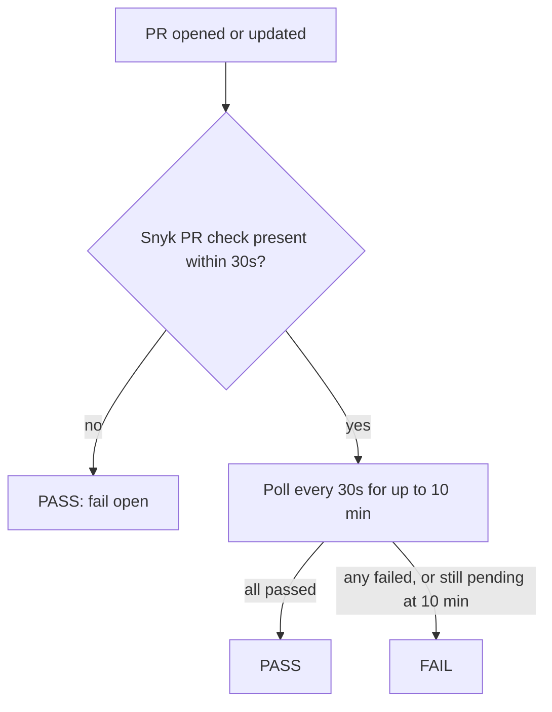
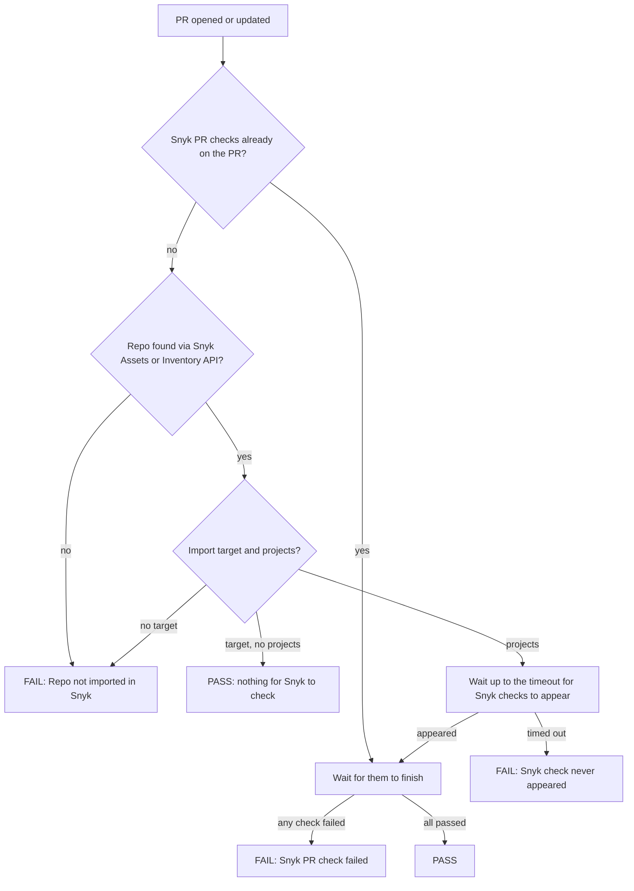

# Snyk PR Check Gatekeeper

A GitHub Actions workflow that turns Snyk's native pull request checks into **one stable, enforceable status** named `snyk-aggregate`. Use it as a **required workflow** in a GitHub ruleset to stop code with new Snyk findings from merging, across one repository, one organization, or every organization in a GitHub Enterprise.

It comes in two variants:

| Variant | File | Needs Snyk credentials | Behavior when Snyk is slow or down |
|---|---|---|---|
| **Fail-open** | [`snyk-aggregate-failopen.yaml`](.github/workflows/snyk-aggregate-failopen.yaml) | **No** | Passes, so developers aren't blocked |
| **Fail-closed** | [`snyk-aggregate.yaml`](.github/workflows/snyk-aggregate.yaml) | Yes (`SNYK_TOKEN`, `SNYK_GROUP_ID`) | Fails, so unscanned code can't merge |

- [Quick start](#quick-start)
- [Rolling it out](#rolling-it-out)
- [Fail-open or fail-closed?](#fail-open-or-fail-closed)
- [Configuration reference](#configuration-reference-fail-closed)
- [Setting secrets across an enterprise](#setting-secrets-across-an-enterprise-fail-closed)
- [Why this exists](#why-this-exists)
- [How it works](#how-it-works)
- [Behavior reference](#behavior-reference)
- [Troubleshooting](#troubleshooting)
- [Repository contents](#repository-contents)

## Quick start

**Requirements**

- Snyk PR checks enabled for the repositories you want to gate, through the Snyk GitHub integration.
- A GitHub plan that supports **required workflows in rulesets** (GitHub Enterprise).
- Fail-closed only: a Snyk API token that can read the group (`group.read`; a read-only service account is best) and your Snyk **group ID**.

**Steps**

1. **Create a central repository** to host the workflow, for example `central-compliance-workflows`.
   - Set its visibility to **Internal**.
   - In *Settings → Actions → General → Access*, allow other repositories to use its workflows:
     *Accessible from repositories in the `<org>` organization*, or for several orgs
     *Accessible from repositories in the `<enterprise>` enterprise*.
2. **Add the workflow.** Copy one of these into `.github/workflows/` in that repository:
   - [`snyk-aggregate-failopen.yaml`](.github/workflows/snyk-aggregate-failopen.yaml): no Snyk credentials needed.
   - [`snyk-aggregate.yaml`](.github/workflows/snyk-aggregate.yaml): also set `SNYK_TOKEN` (secret) and `SNYK_GROUP_ID` (variable) so the repositories you gate can read them. See [Setting secrets across an enterprise](#setting-secrets-across-an-enterprise-fail-closed).
3. **Create a ruleset** that requires the workflow. See [Rolling it out](#rolling-it-out).

Use only one of the two files. Both define a job named `snyk-aggregate`, so having both active in the same repository produces two checks with the same name.

> **Fail-closed note:** a required workflow runs **in the context of each target repository**, not in the central repo. It reads `SNYK_TOKEN` and `SNYK_GROUP_ID` from the *target* repository's organization (or the repo itself), so a secret that only exists in the central repo does not reach the other repos. The fail-open variant needs no secrets, so this doesn't apply to it.

## Rolling it out

The ruleset decides how far the gate reaches.

### Option A: a single repository

1. Add the workflow to `.github/workflows/` in the repo. For fail-closed, also add `SNYK_TOKEN` and `SNYK_GROUP_ID`.
2. In the repo's *Settings → Rules → Rulesets*, require the status check `snyk-aggregate` on the branch you want to protect.

### Option B: a single organization

1. Host the central repo in that organization, with Actions access set to *Accessible from repositories in the `<org>` organization*. For fail-closed, set `SNYK_TOKEN` and `SNYK_GROUP_ID` on the organization, with repository access covering the target repos.
2. In the organization's *Settings → Repositories → Rulesets → New ruleset → New branch ruleset*:
   - **Target repositories:** all repositories, or the subset to enforce.
   - **Target branches:** the default branch, or a pattern such as `main` and `release/*`.
   - Enable **Require workflows to pass before merging** and add the central repo's workflow, pinned to a branch or tag.

### Option C: every organization in a GitHub Enterprise

Create **one ruleset at the enterprise level** and let its targeting do the work:

1. Host the central repo in one organization with **Internal** visibility and Actions access set to *Accessible from repositories in the `<enterprise>` enterprise*.
2. In the enterprise's rulesets, create a new branch ruleset.
   - **Target organizations:** enter `*` for all organizations, or the pattern that matches the ones you want.
   - **Target repositories:** `*`, or the pattern you need.
   - **Target branches:** the default branch, or your pattern.
   - Enable **Require workflows to pass before merging** and add the central repo's workflow.
3. For fail-closed, make sure `SNYK_TOKEN` and `SNYK_GROUP_ID` are available to the organizations the ruleset matches. The [enterprise script](#setting-secrets-across-an-enterprise-fail-closed) does this in one pass. The fail-open variant needs nothing else.

Every organization then enforces the same `snyk-aggregate` check, and the workflow lives in one place.

## Fail-open or fail-closed?

Both variants publish the same `snyk-aggregate` check. They differ in what they do when Snyk hasn't reported a result.

### Fail-open

[`snyk-aggregate-failopen.yaml`](.github/workflows/snyk-aggregate-failopen.yaml) only watches the PR's own checks. It never calls Snyk.

1. It looks for Snyk PR checks on the PR immediately and again after 30 seconds. If none appear, it **passes**.
2. If Snyk checks are present, it polls every 30 seconds, for up to 10 minutes, until none are pending.
3. It **fails** if any Snyk check failed, or if the checks are still pending after 10 minutes.

**Benefits**

- **No Snyk token and no group ID.** There is nothing to create, rotate, or protect, and no per-organization secrets to distribute.
- **Works everywhere, including pull requests from forks**, because it needs only the workflow's built-in `GITHUB_TOKEN`.
- **No dependency on Snyk's APIs.** A Snyk outage or an API change can't break the gate, and a repository that Snyk doesn't scan (a Markdown repo, a repo that was never imported) is never blocked.
- **Simplest to adopt.** Copy one file and add the ruleset.

**Trade-off:** a PR can pass before Snyk has registered its check, for example during an outage or while a repo is being imported. Wait time is capped at 10 minutes.

### Fail-closed

[`snyk-aggregate.yaml`](.github/workflows/snyk-aggregate.yaml) asks Snyk whether the repository should have PR checks, and only passes when Snyk has reported a clean result or has nothing to scan. If checks are expected but never appear, it fails.

**Benefits**

- **Unscanned code can't merge.** A Snyk outage, a disabled integration, or a missing check blocks the PR instead of waving it through.
- **Clear errors.** A repo that isn't in Snyk fails with `Repo not imported in Snyk`, and a check that never shows up fails with an explanation.
- **Waits as long as needed** for the checks to finish, with a configurable time for them to appear (default 2 hours).

**Cost:** it needs a Snyk token and group ID available to every repository it gates.

### Which should I use?

- Choose **fail-open** when you want a simple gate that blocks merges on failing Snyk checks and you accept that a missing check passes.
- Choose **fail-closed** when a missing Snyk check must block the merge.

## Configuration reference (fail-closed)

| Name | Kind | Required | Default | Purpose |
|---|---|---|---|---|
| `SNYK_TOKEN` | Secret | Yes | none | Snyk API token with `group.read` |
| `SNYK_GROUP_ID` | Variable | Yes | none | Snyk group that contains the imported repositories |
| `SNYK_API_BASE` | Variable | No | `https://api.snyk.io` | Snyk API base for your region, for example `https://api.eu.snyk.io` or `https://api.au.snyk.io` |
| `SNYK_CHECK_APPEAR_TIMEOUT_MINUTES` | Variable | No | `120` | How long to wait for Snyk PR checks to appear before failing |

The fail-open variant has no configuration.

## Setting secrets across an enterprise (fail-closed)

[`set-enterprise-snyk-secrets.sh`](set-enterprise-snyk-secrets.sh) sets `SNYK_TOKEN` and `SNYK_GROUP_ID` on every organization in a GitHub Enterprise.

```bash
# One-time: give the GitHub CLI the scopes it needs
gh auth refresh -h github.com -s read:enterprise -s admin:org

# Preview which orgs would be changed (no changes are made)
./set-enterprise-snyk-secrets.sh -e <enterprise-slug> -g <snyk-group-id> -n

# Set them
SNYK_TOKEN=<token> ./set-enterprise-snyk-secrets.sh -e <enterprise-slug> -g <snyk-group-id>
```

| Flag | Meaning |
|---|---|
| `-e` | GitHub enterprise slug (required) |
| `-g` | Snyk group ID (required) |
| `-v` | `private` (default) or `all`. `private` covers private and internal repos; `all` also includes public repos |
| `-n` | Dry run: list the orgs and what would be set |

The token is read from the environment, so it doesn't appear in shell history or the process list. Re-run the script with a new token to rotate it in every org.

## Why this exists

Application security teams often want to stop developers from merging pull requests that introduce new vulnerabilities. A GitHub ruleset looks like the obvious tool, but there is a catch:

- Snyk's PR checks are named per Snyk organization, for example `security/snyk (<snyk-org-name>)`. The name is different for every Snyk org.
- Rulesets match required status checks by **exact name**. GitHub has no wildcard support, so one ruleset can't require "any Snyk check" across many repositories.

This workflow publishes a fixed check name, `snyk-aggregate`, that a ruleset can require everywhere. It doesn't re-run any scanning. It waits on Snyk's own PR checks, so the result reflects the full contents of the code being merged.

### Design goals

| Goal | How it's met |
|---|---|
| Block merges when Snyk PR checks fail | `snyk-aggregate` fails if any Snyk check fails |
| Keep the gate open when Snyk has nothing to check (for example a Markdown-only repo) | An imported repo with no projects passes |
| Optionally, don't fail open during a Snyk outage or an import | The fail-closed variant fails if expected checks never appear |
| Work across many GitHub organizations under one enterprise | One required workflow, one stable check name |

## How it works

### Fail-open



### Fail-closed



1. **Check the PR first.** If a Snyk PR check is already on the PR (any check whose name contains `snyk`, other than the gate itself), the gate skips the Snyk APIs and goes straight to waiting for it.
2. **Otherwise look the repo up in Snyk.** It searches the Snyk group by repository URL, using both the group **Assets** search and the **Inventory** API. A repo found by either is known to Snyk.
   - Not found in either → **fail** with `Repo not imported in Snyk`.
   - Found but with no import target → **fail** with the same message.
   - Has an import target but no projects → **pass**, because there is nothing for Snyk to scan.
   - Has projects → Snyk PR checks are expected, so wait for them.
3. **Wait for the checks to appear**, for up to `SNYK_CHECK_APPEAR_TIMEOUT_MINUTES` (default 120 minutes). If they never show up, **fail** with an explanatory error.
4. **Wait for the checks to finish.** The only limit is the job timeout (6 hours, the GitHub-hosted runner maximum). If any Snyk check failed, the gate fails. If all passed, it passes.

Every run writes a one-line summary to the job summary page.

## Behavior reference

| Situation | Fail-open | Fail-closed |
|---|---|---|
| No Snyk check appears (repo not scanned, outage, mid-import) | **Pass** after 30 seconds | Depends on the Snyk lookup (rows below) |
| Repo not found in Snyk Assets or Inventory | not checked | **Fail**: `Repo not imported in Snyk` |
| Repo found, no import target | not checked | **Fail**: `Repo not imported in Snyk` |
| Repo imported, target has no projects | not checked | **Pass** |
| Repo imported with projects, no Snyk check appears in time | not checked | **Fail**: timeout error listing likely causes |
| Snyk checks appear and all pass | **Pass** | **Pass** |
| A Snyk check fails | **Fail** | **Fail** |
| Snyk checks still pending after the wait | **Fail** after 10 minutes | Keeps waiting, up to the job timeout |
| `SNYK_TOKEN` or `SNYK_GROUP_ID` unavailable | not needed | **Fail**, and the message says which is missing (unless a Snyk check is already on the PR) |
| Snyk API error | not used | **Fail**, with the API path and HTTP status |

## Troubleshooting

| Symptom | Likely cause and fix |
|---|---|
| Fail-closed: `SNYK_TOKEN secret is not available` | The secret isn't set for this repo's org, the repo isn't in the secret's repository access list, or the PR is from a fork |
| Fail-closed: `SNYK_GROUP_ID ... is not set` | The variable is missing or its repository access doesn't include this repo |
| Fail-closed: `Repo not imported in Snyk` on a repo you expect to be imported | Check that the repo is imported in the Snyk group named by `SNYK_GROUP_ID`, that the token can read that group, and that `SNYK_API_BASE` matches your Snyk region |
| Fail-closed: `Snyk asset search failed` or an HTTP 401/403/404 from Snyk | Wrong region (`SNYK_API_BASE`), invalid or expired token, or the token lacks `group.read` |
| Fail-closed: no Snyk check appeared within the timeout | Snyk PR checks may be disabled for the repo or branch, the PR targets a branch Snyk doesn't monitor, or Snyk is having an outage. Re-run the job after fixing it, or raise `SNYK_CHECK_APPEAR_TIMEOUT_MINUTES` |
| Two checks named `snyk-aggregate` on a PR | More than one workflow in the repo defines a job with that name. Keep a single one |

## Repository contents

| Path | Purpose |
|---|---|
| [`.github/workflows/snyk-aggregate-failopen.yaml`](.github/workflows/snyk-aggregate-failopen.yaml) | The fail-open gate: no Snyk credentials needed |
| [`.github/workflows/snyk-aggregate.yaml`](.github/workflows/snyk-aggregate.yaml) | The fail-closed gate |
| [`set-enterprise-snyk-secrets.sh`](set-enterprise-snyk-secrets.sh) | Sets the Snyk secret and variable on every org in an enterprise (fail-closed) |
