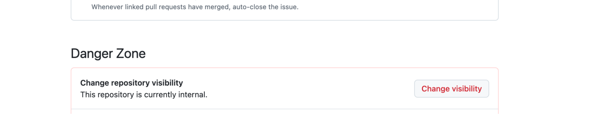
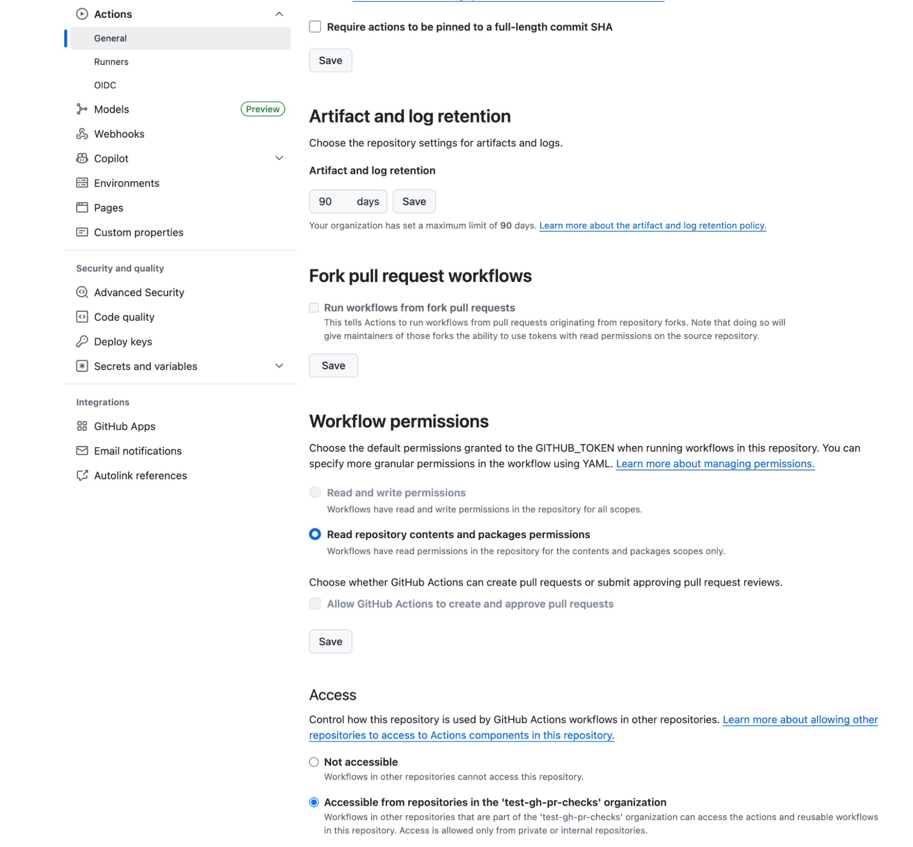
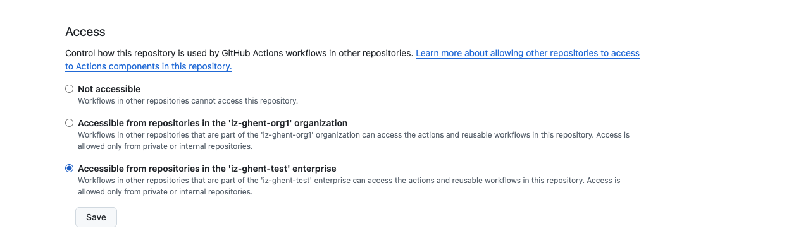
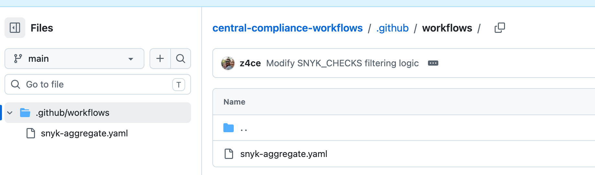
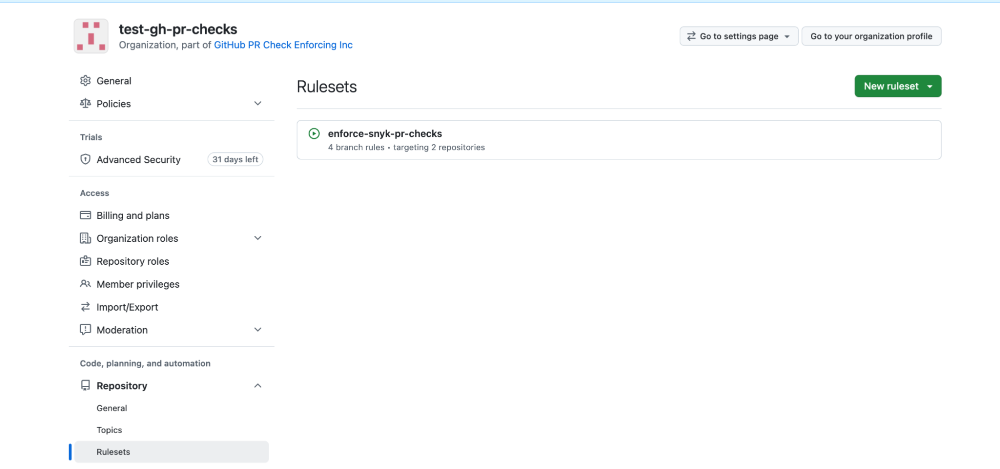
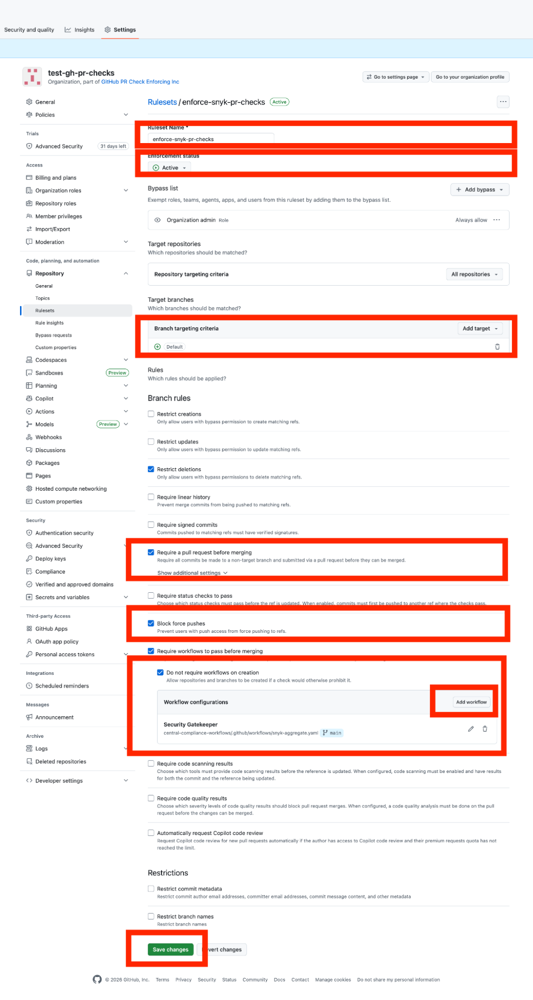
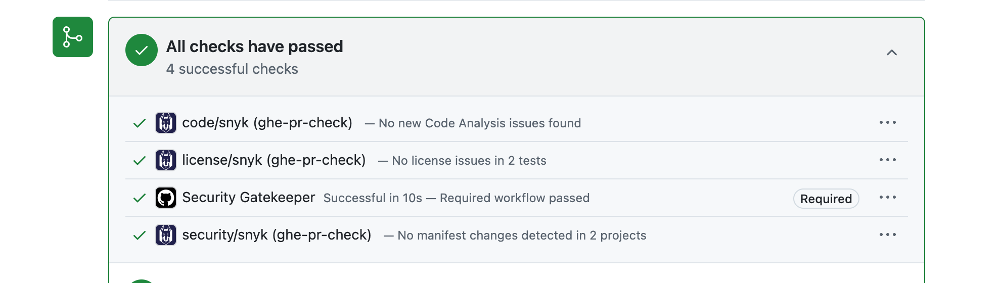
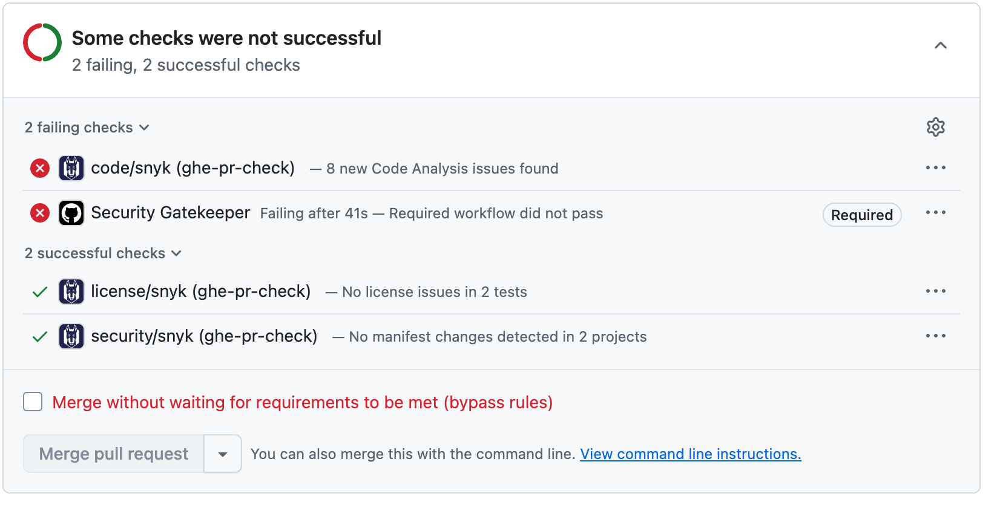

# Setup guide

Step-by-step instructions, with screenshots, for blocking merges on Snyk PR checks using a GitHub **required workflow**. For the concepts and the fail-open versus fail-closed choice, see the [README](../README.md).

- [Overview](#overview)
- [Prerequisites](#prerequisites)
- [Step 1: Create the central repository](#step-1-create-the-central-repository)
- [Step 2: Add the workflow](#step-2-add-the-workflow)
- [Step 3: Create the ruleset](#step-3-create-the-ruleset)
- [Step 4: Verify it works](#step-4-verify-it-works)

## Overview

GitHub rulesets match required status checks by exact name, and Snyk's PR checks carry the name of the Snyk organization, for example `security/snyk (<snyk-org-name>)`. A ruleset therefore can't say "require any Snyk check" across many repositories.

The fix is a **required workflow** that aggregates Snyk's PR checks into one check with a fixed name, `snyk-aggregate`. You host the workflow once in a central repository, and a ruleset makes it mandatory for the repositories you choose.

You will:

1. Create a central repository that hosts the workflow.
2. Add the workflow file to it.
3. Create a ruleset that requires the workflow.
4. Open test PRs to confirm the gate behaves.

## Prerequisites

- Snyk PR checks enabled for the repositories you want to gate.
- A paid GitHub Organization with GitHub Enterprise. Required workflows in rulesets aren't available on free plans.
- Permission to create a repository and a ruleset in the organization (or enterprise) you're setting up.
- If you choose the fail-closed workflow: a Snyk API token (`group.read`) and your Snyk group ID. The fail-open workflow needs neither.

## Step 1: Create the central repository

Create a new repository to host the enterprise workflows. This guide calls it `central-compliance-workflows`; any name works.

### Make the repository internal

Open *Settings → General*, scroll to the **Danger Zone**, and confirm it says *This repository is currently internal*. Use **Change visibility** if it doesn't. Internal visibility lets other repositories in your organization or enterprise use the workflow without making it public.

### Let other repositories use its workflows

Open *Settings → Actions → General* and scroll to **Access**. Pick the scope that matches how far you want the gate to reach, then click **Save**.

**One organization:** choose *Accessible from repositories in the `<org>` organization*.

**Several organizations in an enterprise:** choose *Accessible from repositories in the `<enterprise>` enterprise*.

Access is allowed only from private or internal repositories.

## Step 2: Add the workflow

Create the workflow file in the central repository at `.github/workflows/snyk-aggregate.yaml`. Choose the variant that fits:

| Variant | Source file | Credentials needed |
|---|---|---|
| Fail-open | [`snyk-aggregate-failopen.yaml`](../.github/workflows/snyk-aggregate-failopen.yaml) | None |
| Fail-closed | [`snyk-aggregate.yaml`](../.github/workflows/snyk-aggregate.yaml) | `SNYK_TOKEN` secret and `SNYK_GROUP_ID` variable |

Copy the contents of the file you chose into `.github/workflows/snyk-aggregate.yaml` in the central repository. Use only one variant, because both define a job named `snyk-aggregate`.

**Fail-closed only:** also set the credentials where the gated repositories can read them. A required workflow runs in the context of each target repository, so it reads secrets and variables from that repository's organization, not from the central repo.

- Set `SNYK_TOKEN` (secret) and `SNYK_GROUP_ID` (variable) on each organization that contains gated repositories, with repository access that includes them.
- To do this for every organization in an enterprise in one pass, use [`set-enterprise-snyk-secrets.sh`](../set-enterprise-snyk-secrets.sh). See [Setting secrets across an enterprise](../README.md#setting-secrets-across-an-enterprise-fail-closed).

## Step 3: Create the ruleset

### Organization ruleset

In the organization's settings, go to *Repository → Rulesets* and choose **New ruleset → New branch ruleset**.

Fill in the ruleset:

1. **Ruleset name:** for example `enforce-snyk-pr-checks`.
2. **Enforcement status:** **Active** to enforce, or **Evaluate** to try it without blocking anyone.
3. **Target repositories:** all repositories, or the subset you want to enforce.
4. **Target branches:** add the default branch, and any other pattern you want protected.
5. **Branch rules**, enabled for the blocking behavior:
   - **Require a pull request before merging**
   - **Require workflows to pass before merging**, then click **Add workflow** and choose the central repository's `.github/workflows/snyk-aggregate.yaml` on `main`.
   - Optionally **Restrict deletions** and **Block force pushes**.
6. Click **Save changes**.

> The workflow's display name in the screenshot (*Security Gatekeeper*) comes from the `name:` field in the workflow file. The fail-closed variant is named *Security Gatekeeper (Assets API)*.

### Enterprise ruleset (every organization)

To cover all organizations under an enterprise, create **one ruleset at the enterprise level** instead of one per organization. It has the same options as above, plus targeting for organizations:

- **Target organizations:** enter `*` to include every organization, or the pattern that matches the ones you want.
- **Target repositories:** `*`, or the pattern you need.
- **Target branches:** the default branch, or your pattern.
- **Require workflows to pass before merging:** add the central repository's `snyk-aggregate.yaml`.

Every matched organization then enforces the same `snyk-aggregate` check from the one central copy.

## Step 4: Verify it works

Open a pull request in a repository the ruleset covers and check the result on the PR.

### A PR with no new issues

All Snyk checks pass, the required workflow passes, and the PR can be merged. The gate shows as **Required**.

Note the per-organization names of Snyk's own checks, such as `security/snyk (ghe-pr-check)`. That is the naming problem the aggregate check works around.

### A PR that introduces new issues

A Snyk check fails, so the required workflow fails and the **Merge pull request** button is disabled.

If the behavior isn't what you expect, see [Troubleshooting](../README.md#troubleshooting).
